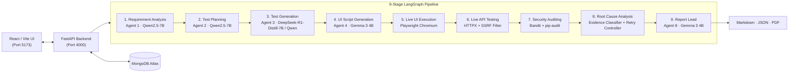

<div align="center">

# 🧪 AgentQA

### Multi-Agent Software Testing & Bug Analysis Platform

*Feed it an SRS. Get tested software, root causes and an executive quality report.*


[Overview](#-overview) •
[Features](#-core-capabilities) •
[Architecture](#-system-architecture) •
[Agents](#-the-eight-agents) •
[Getting Started](#-getting-started) •
[Testing](#-testing--verification) •
[Docker](#-docker-deployment) •
[Security](#-security--safe-testing-guidelines)

</div>

---

## 📖 Table of Contents

1. [Overview](#-overview)
2. [Core Capabilities](#-core-capabilities)
3. [System Architecture](#-system-architecture)
4. [The Eight Agents](#-the-eight-agents)
5. [Tech Stack](#-tech-stack)
6. [Getting Started](#-getting-started)
7. [Testing & Verification](#-testing--verification)
8. [Docker Deployment](#-docker-deployment)
9. [Security & Safe Testing Guidelines](#-security--safe-testing-guidelines)
10. [Project Structure](#-project-structure)
11. [Documentation](#-documentation)
12. [Roadmap](#-roadmap)
13. [License](#-license)

---

## 🎯 Overview

**AgentQA** is a production-grade automated quality assurance platform driven by a **LangGraph multi-agent AI pipeline**, a **FastAPI** backend, **MongoDB Atlas** persistence and a **React/Vite** dashboard.

It ingests a **Software Requirements Specification (SRS)** and coordinates eight specialized AI agents to:

- plan and generate test cases,
- run **real** Playwright browser automation,
- perform **live** HTTPX API testing behind strict SSRF controls,
- run **real** Bandit and pip-audit security audits,
- perform evidence-based **Root Cause Analysis (RCA)**,
- apply controlled **self-healing** retries,
- and compile an executive quality report exportable to **Markdown, JSON and PDF**.

> 🧠 Models run locally through **Ollama**, so no source code or requirements leave your machine.

---

## ✨ Core Capabilities

| Capability | What it does |
| --- | --- |
| 🤖 **Multi-agent orchestration** | Eight specialized agents run sequentially with isolated state management in LangGraph |
| 🌐 **Real browser automation** | Headless Chromium via Playwright, with automatic screenshots on failure |
| 🔌 **Real API testing** | Live HTTP requests with configurable assertions, latency benchmarks and SSRF destination validation |
| 🛡️ **Static security auditing** | Subprocess-isolated **Bandit v1.9.4** (Python AST) and **pip-audit v2.10.1** (dependency CVEs); degrades cleanly when Semgrep is unavailable |
| 🔍 **Evidence-based RCA** | Turns tracebacks, HTTP codes, CVEs and DOM state into 7 failure categories, separating verified facts from LLM hypotheses |
| 🩹 **Controlled self-healing** | Retry controller with max 2 retries, exponential backoff, before/after diff tracking and strict no-retry rules for security, auth and deterministic failures |
| 🔐 **Production hardening** | bcrypt password hashing, expiring JWTs, cross-tenant project/run isolation, startup guards against default credentials, path-traversal protection |
| 📄 **Enterprise reporting** | Run reports as Markdown (`.md`), raw JSON and printable HTML/PDF |

---

## 🏗️ System Architecture



---

## 🤖 The Eight Agents

| # | Agent | File | Role |
| --- | --- | --- | --- |
| 1 | Requirement Analyst | `agent1_requirement.py` | Parses the SRS into structured requirements |
| 2 | Test Planner | `agent2_planner.py` | Builds the test strategy and coverage plan |
| 3 | Test Generator | `agent3_generator.py` | Generates detailed test cases |
| 4 | UI Automation | `agent4_ui_automation.py` | Creates and runs Playwright browser scripts |
| 5 | API Testing | `agent5_api_testing.py` | Runs live HTTPX tests with SSRF protection |
| 6 | Security Testing | `agent6_security_testing.py` | Bandit and pip-audit scans |
| 7 | Root Cause Analysis | `agent7_rca.py` | Classifies failures and drives bounded retries |
| 8 | Report Lead | `agent8_report.py` | Compiles the executive quality report |

---

## 🧰 Tech Stack

| Layer | Technology |
| --- | --- |
| **Orchestration** | LangGraph |
| **LLMs (local)** | Ollama: `qwen2.5:7b`, `gemma3:4b`, `deepseek-r1:7b` |
| **Backend** | FastAPI, Uvicorn |
| **Database** | MongoDB Atlas (or local MongoDB) |
| **Frontend** | React, Vite, TypeScript |
| **UI testing** | Playwright (Chromium) |
| **API testing** | HTTPX |
| **Security scanning** | Bandit, pip-audit |
| **Auth** | bcrypt, JWT |
| **Deployment** | Docker, Docker Compose |

---

## 🚀 Getting Started

### Prerequisites

- **Python** 3.11, 3.12 or 3.13 (3.13.5 supported)
- **Node.js** v18+ and npm
- **Ollama** installed and running, with these models:

  ```bash
  ollama pull qwen2.5:7b
  ollama pull gemma3:4b
  ollama pull deepseek-r1:7b
  ```

- **MongoDB**: an Atlas connection string, or a local instance on port 27017

### 1. Clone and configure

```bash
git clone https://github.com/boomiikas/Multi-Agent-Software-Testing-and-Bug-Analysis-Platform-.git
cd Multi-Agent-Software-Testing-and-Bug-Analysis-Platform-
cp .env.example .env
```

Then edit `.env`:

```env
PORT=4000
HOST=127.0.0.1
ENVIRONMENT=development
CLIENT_ORIGIN=http://localhost:5173
MONGODB_URL=your_mongodb_connection_string
MONGODB_DB_NAME=agentqa
JWT_SECRET=your_secure_random_jwt_secret_key
DEFAULT_ADMIN_EMAIL=admin@example.com
DEFAULT_ADMIN_PASSWORD=Admin@123
```

### 2. Install Python dependencies and Playwright

```bash
pip install -r requirements.txt
pip install bandit pip-audit uvicorn

python -m playwright install chromium
```

### 3. Install frontend dependencies

```bash
npm install
```

### 4. Run the application

**Terminal 1 — backend**

```bash
python -m uvicorn backend.main:app --host 127.0.0.1 --port 4000 --reload
```

Health check: <http://127.0.0.1:4000/api/health>

**Terminal 2 — frontend**

```bash
npm run dev
```

Open <http://localhost:5173>. The seeded development admin is `admin@example.com` / `Admin@123`.

> ⚠️ Change the default admin password and `JWT_SECRET` before any real deployment.

---

## ✅ Testing & Verification

```bash
# Everything
python -m pytest

# Feature modules
python -m pytest tests/test_api_testing.py           # Real API testing & SSRF
python -m pytest tests/test_security_scanning.py     # Bandit & pip-audit
python -m pytest tests/test_rca_and_healing.py       # RCA & retry controller
python -m pytest tests/test_pipeline_integration.py  # Multi-agent pipeline & recovery
python -m pytest tests/test_production_security.py   # Auth isolation & startup guards

# Frontend build check
npm run build
```

---

## 🐳 Docker Deployment

```bash
# Build and start
docker-compose up --build -d

# Follow logs
docker-compose logs -f
```

| Service | URL |
| --- | --- |
| Frontend | <http://localhost> (port 80) |
| Backend | <http://localhost:4000> |

---

## 🔒 Security & Safe Testing Guidelines

1. **SSRF restrictions.** Targets pointing to loopback (`127.0.0.1`, `localhost`), private RFC 1918 ranges (`10.0.0.0/8`, `172.16.0.0/12`, `192.168.0.0/16`) or cloud metadata (`169.254.169.254`) are rejected, including malicious redirects.
2. **Credential redaction.** Sensitive headers (`Authorization`, `Cookie`, `X-Api-Key`) and JSON fields (`password`, `token`, `secret`) are redacted before logging and database storage.
3. **Controlled self-healing.** The platform never modifies code on its own or weakens security assertions. Retries are capped at 2 attempts; SSRF, auth and CVE failures always need human review.
4. **Production safeguard.** With `ENVIRONMENT=production`, the app refuses to start if the default `JWT_SECRET` or the default admin password is detected.

---

## 📁 Project Structure

```
.
├── agent1_requirement.py      # Agent 1: requirement analysis
├── agent2_planner.py          # Agent 2: test planning
├── agent3_generator.py        # Agent 3: test case generation
├── agent4_ui_automation.py    # Agent 4: Playwright UI automation
├── agent5_api_testing.py      # Agent 5: live API testing
├── agent6_security_testing.py # Agent 6: Bandit + pip-audit
├── agent7_rca.py              # Agent 7: root cause analysis
├── agent8_report.py           # Agent 8: report generation
├── main.py                    # Pipeline entry point
├── backend/                   # FastAPI application
├── server/                    # Server components
├── src/                       # React / Vite frontend
├── public/                    # Static assets
├── tests/                     # Pytest suite
├── agent_outputs/             # Generated agent artifacts
├── screenshots/               # UI screenshots
├── report_assets/             # Figures used in the project report
├── Dockerfile.backend
├── Dockerfile.frontend
├── docker-compose.yml
├── requirements.txt
├── package.json
├── .env.example
└── LICENSE
```

---

## 📚 Documentation

- **Project report:** `AgentQA_Project_Report.docx`
- **Requirements:** `srs_document.txt`

---

## 🗺️ Roadmap

- [ ] Support for additional LLM providers beyond Ollama
- [ ] CI/CD integration (GitHub Actions) for automatic runs on pull requests
- [ ] Mobile and accessibility testing agents
- [ ] Trend dashboard across historical runs

---

## 📄 License

Released under the [MIT License](LICENSE).

---

<div align="center">
  
⭐ If you find this useful, consider starring the repo!

</div>
